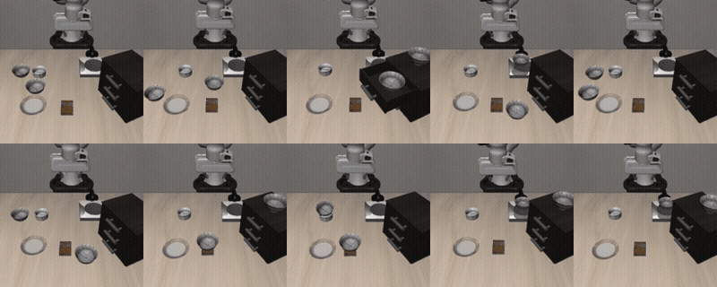
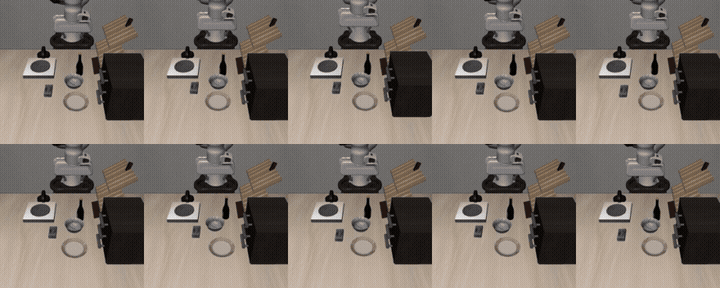
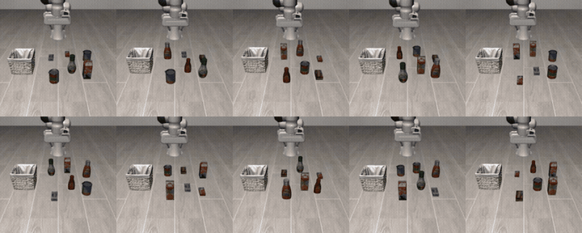
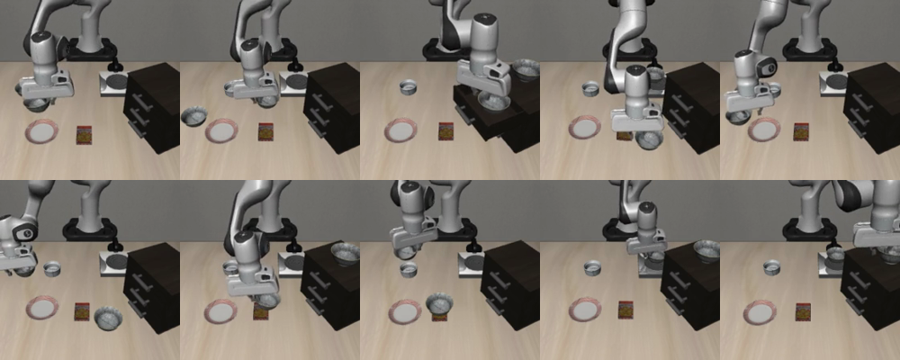

<!-- 中文；English: PI05.md -->

# π0.5 跑在 RDK S100P 上

`bllm` 在板子的 BPU 上运行 [openpi](https://github.com/Physical-Intelligence/openpi) 的 **π0.5**
视觉-语言-动作策略。输入两帧相机图和一句英文指令，输出一个末端 delta 动作块，
三张图（4.6 GB）同时常驻，**每个动作块约 1 s**。

在 LIBERO 上，用 openpi 自己的评测 harness，板上成绩与 x86 参考持平：

| suite | 板上 | 参考（GPU） |
|---|---:|---:|
| libero_spatial | **99 / 100** | 99 / 100 |
| libero_goal | 97 / 100 | — |
| libero_object | 95 / 100 | — |

`libero_spatial` 这一行是**模型包本身**——`bllm.load_policy()` 直接接到 openpi 的 harness，
环路里没有 openpi 的任何 transform。这才是该期待的数字，因为你拿到的就是这条代码路径。

作为对照，同样三张图反过来驱动——在主机上跑 openpi 的 transform，只把
`Policy._sample_actions` 换成板子（这个移植就是这样开发的，上面 `goal` 和 `object`
也是这样打的分）——在 `libero_spatial` 上得 100 / 100。一百个 episode 里差一个，
σ ≈ 1，这就是外围流水线两种实现之间的全部差别。

每个任务一次回放，每个 suite 全部十个任务，在板上运行。这些是成功的 episode；
每个 suite 在 100 个 episode 上的成功率见上表。

**`libero_spatial`**——指令按与另一物体的空间关系指明是*哪一只*黑碗，所以策略必须
读懂指令，而不是猜：



**`libero_goal`**——动词各不相同，还有铰接物体：拉开抽屉、打开灶台、把东西放进去：



**`libero_object`**——动作相同，每次换一个指名的物体，画面里还有若干干扰物：



`libero_spatial` 回放中途的一帧静止画面，十个任务里碗都已离开桌面、正在送往盘子：



## 板上实测

以下全部在 **RDK S100P** 上实测——6 × Cortex-A78AE、8 GB、BPU Nash——三张图同时常驻。
没有主机，没有 GPU，没有卸载。

| | |
|---|---|
| 动作块 | **1016 ms**（10 次均值，板上计时） |
| ↳ SigLIP So400m，2 路相机 | 169 ms |
| ↳ PaliGemma prefill，544 token | 602 ms |
| ↳ 动作专家，10 步去噪 | 235 ms |
| 每块输出 | 10 × 7 末端 delta |
| 控制频率 | 推理约 1 Hz → 按 LIBERO 每 5 步重规划，**动作约 5 Hz** |
| 常驻图 | 4.57 GB（SigLIP 1.1 + PaliGemma 3.0 + 专家 0.46） |
| **进程 RSS** | **16 MB**——权重在 BPU/ION，不在你的地址空间里 |
| **推理时 CPU** | **6 核里约 1.3 核**——算术在 BPU 上，A78AE 核留给感知与控制 |
| BPU 芯片温度 | 52–54 °C，被动散热 |

值得细看的是最后两项。一个占满六个 CPU 核的策略，就没有余力去真正驱动机器人了；
这里 CPU 核是空闲的，模型甚至不在进程内存里，所以感知栈和控制器可以与它共用一块板子。

## 获取

编译好的模型包在 Hugging Face——
**[ruisv/bllm-pi05-libero-224-s100p](https://huggingface.co/ruisv/bllm-pi05-libero-224-s100p)**
（5.3 GB：三张 `.hbm`、embedding 表、tokenizer 和清单）。

```bash
huggingface-cli download ruisv/bllm-pi05-libero-224-s100p \
    --local-dir pi05-libero-224-s100p
```

这些是派生权重——openpi 的 π0.5 checkpoint 编译到 BPU，配 Google 的 PaliGemma tokenizer。
来源与上游条款见 model card。

## 使用

```python
import bllm
import numpy as np

policy = bllm.load_policy("pi05-libero-224-s100p")

actions = policy.act(scene_rgb,           # uint8[h, w, 3], any resolution
                     wrist_rgb,           # uint8[h, w, 3]
                     "pick up the black bowl and place it on the plate")
# actions: float32[10, 7] — end-effector deltas in the dataset's own units,
# already unnormalised. Feed them to the arm one row at a time.
```

模型包自带 tokenizer、embedding 表和归一化统计量，运行时不需要 openpi，也不需要 14 GB 的 checkpoint。

另有一个 C++ 入口 `examples/pi05_policy.cc`，从命令行做同样的事。它是示例而不是随包发布的
二进制——conda 包用 `BLLM_BUILD_EXAMPLES=OFF` 构建——所以需要从源码构建：

```bash
cmake -S . -B build -DBLLM_BUILD_EXAMPLES=ON && cmake --build build
./build/examples/bllm_pi05_policy --model pi05-libero-224-s100p \
    --image scene.jpg --wrist wrist.jpg \
    --prompt "pick up the black bowl and place it on the plate"
```

### 钉住隐变量

π0.5 是从高斯隐变量积分出来的 flow 模型，所以**同一观测调用两次，返回不同的动作是正常的**。
在真实观测上这个散布很小（‖a‖ 变化约 4 %），但在夹爪开合的切换点上是整整 ±1 的翻转。
需要两次运行可比时传 `noise=`——不传就拿一个实现和参考对比，测到的是策略自身的随机性，
而不是实现：

```python
z = np.random.default_rng(0).standard_normal((policy.horizon, 32)).astype(np.float32)
a1 = policy.act(scene, wrist, prompt, noise=z)
a2 = policy.act(scene, wrist, prompt, noise=z)     # bit-identical
```

## 制作模型包

在转换主机上分两步，都在 `host_toolchain/convert/pi05/` 下：

```bash
# 1. everything that is not a graph: tokenizer, embedding table, action
#    quantiles, flow-matching conditioning table
python export_pi05_package.py --ckpt ckpt_pytorch --out /tmp/pi05_pkg

# 2. assemble the manifest around the three .hbm
bllm-make-model-dir pi05 ~/models/pi05-libero-224-s100p \
    --hbm        pi05_paligemma.hbm     `# PaliGemma prefill` \
    --visual     pi05_siglip.hbm        `# SigLIP tower` \
    --expert     pi05_expert.hbm        `# action expert` \
    --embed      /tmp/pi05_pkg/embed_f16.bin \
    --cond-table /tmp/pi05_pkg/cond_table.f32 \
    --norm-stats /tmp/pi05_pkg/norm_stats.json \
    --tokenizer  /tmp/pi05_pkg/tokenizer.json
```

`export_pi05_package.py` 会自检输出：导出的 `tokenizer.json` 必须在一组真实指令上与
sentencepiece 的 id 完全一致，因为差一个 id 的 tokenizer 会得到一个通顺但*不同*的任务，
下游任何数值检查都发现不了。

## 量化

三张图的量化方式并不统一，所以给模型包名加一个后缀会说错。各自的情况：

| 图 | 权重 | 激活 |
|---|---|---|
| SigLIP 塔 | int8 逐输出通道 | int16 静态逐张量 |
| PaliGemma prefill | int8 逐输出通道 | int16 静态逐张量 |
| 动作专家 | int8 逐输出通道，`action_out_proj` 与最后的 adaRMSNorm 用 **int16** | int16 静态逐张量 |

动作头用 16 位，是因为夹爪指令是双峰的（约 ±1），而 `action_out_proj` 是唯一决定它的层：
数值离判决边界远的地方 int8 没问题，到了交界处就是致命的。

顺带一提，这个移植的误差并不在量化上。在 openpi 自己的模型里复现板上的精确方案——三张图
一起——只损失动作幅值的 **0.05 %**。动态逐 token 范围能找回其中的 0.3 %，代价是在这块 BPU
上每个 matmul 约 400 倍的开销，所以这些图用的是静态量化。

## 模型包里有什么，以及每一件为什么必需

| 文件 | 为什么运行时推断不出来 |
|---|---|
| `visual.hbm`、`model.hbm`、`expert.hbm` | SigLIP 塔、PaliGemma prefill、动作专家 |
| `embed_tokens.bin` | 共享的 embedding 表——257152 × 2048，mmap 映射 |
| `tokenizer.json` | PaliGemma 的 tokenizer |
| `cond_table.f32` | flow-matching 条件，按去噪步预先算好 |
| `norm_stats.json` | 7 个真实动作维度的 q01/q99 |
| `pi05.cameras`、`pi05.prompt_len` | 前缀正是按这么多个相机槽和 prompt 槽编译的 |
| `pi05.horizon`、`pi05.steps` | 动作块长度和去噪步数，都固化在图里 |
| `pi05.embed_prescaled` | 见下文 |

**`embed_prescaled` 不是记账用的。** openpi 的 `embed_prefix` 在调用 `embed_language_tokens`
*之后*，把共享 embedding 行乘以 `sqrt(hidden)` = √2048 ≈ 45.25。一个直接发原始行的模型包
会让 prompt 小 45 倍——策略几乎读不懂自己的指令——而且没有任何东西能发现：与同样方式构建的
golden 比端到端 cosine 仍是 0.99995，因为 cosine 与尺度无关，两边带着同样的误差。这个移植
就这样跑了好几个月，72/100，而参考是 99。所以表按预缩放存储，清单里没写明这一点的，运行时
**直接拒绝**。

## 限制

* **只有一种配置。** 只支持 `pi05_libero`。它是官方 π0.5 配置里唯一 `discrete_state_input=False`
  的；`pi05_droid` 和 `pi05_aloha` 把 32 个状态值离散化进 prompt（**145 token**，而这张图只有
  32 个槽），用 3 路相机而不是 2 路，`action_horizon` 是 15/50 而不是 10。这些都是编译期形状，
  所以需要各自的图——按 `prompt_len ≈ 160`、3 路相机重编一次就能覆盖两种前缀，只剩 horizon
  按具身形态各编。
* **指令必须放得进 `prompt_len`。** 四个 LIBERO suite 的指令都是 6–21 token，槽位 32 个。
  更长的指令是硬错误，绝不静默截断——被截断的指令读起来是一个通顺但不同的任务。
* **刻意不用本体感知。** `pi05_libero` 配置为 `discrete_state_input=False`，而 `embed_suffix`
  只在 `!pi05` 时才用 `state_proj`，所以 openpi 自己的 LIBERO π0.5 从不读状态向量。
  `Pi05Observation::state` 为了 API 稳定而接受，但被忽略。
* **图像预处理是普通的双线性缩放**，保持宽高比、补零填充，而 openpi 用的是 PIL 的。两者在
  大幅缩小时略有差别；在 LIBERO 的 256 → 224 下，板上与参考的配对检查纹丝不动。想彻底消除
  这个疑问，直接喂 224×224。
